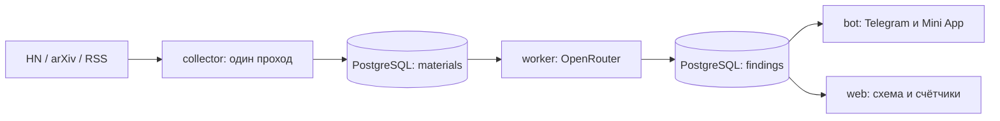

# Архитектура

## Актуальное подключение T18

Worker использует только AITunnel через worker/config.py: GLM для первого editorial_fit/draft и доработок, Haiku для review. Транспорт остаётся urllib, новых служб/зависимостей нет. Общие лимиты 8/60/80 сохраняются. worker/recovery.py переносит только известный совместимый draft из старого процесса на свежий review, сохраняя историю и происхождение; неизвестные платные ответы удерживаются. Старый ключ/общая MODEL не включают обработку. Подробности и границы проверки — SPEC.md и tests/T18_RESULTS.md. Остальные снимки ниже исторические.

## Актуальная локальная реализация T17

T17 утверждена, PostgreSQL/стендовая приёмка ещё не завершена. Службы прежние. collector/sources.py отделяет ограниченный HTTP, robots/cooldown, разбор двух русских издателей и PLOS, API-cursor в существующих runs от модели. collector/main.py сохраняет исходники и распределяет до 30 кандидатов. worker/planning.py выбирает ограниченный пул по разнообразию/языку; evidence.py проверяет происхождение/тип; contracts.py/prompts.py задают допуск research/news/guide. Существующий stages.py хранит конечные ступени/checkpoint, main.py — публикационную транзакцию; бюджет общий 8/60/80 UTC. Это модули прежних служб, не новые сервисы.

Публичный v2 читается bot/Mini App и web вместе с v1. Добавлены питание, тип/оригинал/атрибуция, убран обязательный блок ограничений новых карточек; светлая тема T16 сохраняется. Длинная Telegram-сводка делится по карточкам. Новых таблиц/моделей/зависимостей нет. Источник и русский язык не являются допуском. Расписание Collector внешнее; Worker его не запускает. Совместимое обновление — SPEC.md и specs/T17-owner-feed/COOLIFY.md. Старые разделы ниже — история.

Статус: текущее устройство подтверждено аудитом; целевое устройство и варианты — предложения. Основание и ограничения проверки: [AUDIT.md](AUDIT.md).

T01 утверждена: в коде добавлены статус публикации и фильтры published в читательских путях. Worker сохраняет draft через значение по умолчанию БД. Полная приёмка ожидает PostgreSQL-проверок; результаты — [tests/T01_RESULTS.md](tests/T01_RESULTS.md). Описание «Сейчас» ниже относится к исходному коммиту аудита.

После T01 пользователь сообщил о запуске в Coolify. T02 утверждена и подготовлена в коде: Europe PMC API + ScienceDaily RSS → существующий Collector → materials с исходной записью и status=collected. Состояние ожидания исключает новый корпус из старого AI-Worker до T03. Новый адаптер находится внутри Collector; новых сервисов и моделей нет. Обновление существующей БД предусмотрено, но PostgreSQL-проверки не выполнены: tests/T02_RESULTS.md. Полный путь до публикации предложен отдельно в specs/T03-publication/SPEC.md; до её утверждения этот путь не реализован.

## Сейчас

Все блоки находятся в одном репозитории и общем Docker-образе, но запускаются независимо. PostgreSQL одновременно хранит входы, результаты, очередь через materials.status и журнал runs. Бот совмещает Telegram и читательскую страницу. `web` не является основной Mini App. Сбор однократный, расписание задаётся извне. Модель вызывается только в worker. Подробнее о компонентах и рисках — в аудите.

## Что можно сохранить без функциональных изменений на старте

| Основа | Условия повторного использования |
|---|---|
| Разделение collector / DB / worker / интерфейсы | Сохранить существующие процессы и БД |
| `main.py` и общий Dockerfile | Не требуется новый сервис; учитывать способ передачи BLOCK |
| psycopg, параметры окружения, параметризованные SQL | Не менять стек; локальная среда пока не готова |
| runs и вспомогательные функции журнала | Достаточны как основа, не полная наблюдаемость редакции |
| RSS-reader и однократный цикл collector | Подходит лишь к совместимому RSS; качество и полнота входа потребуют доработки |
| Telegram long polling, Mini App SDK, базовый CSS | Транспорт и каркас остаются; тексты, данные и допуск изменятся |
| PostgreSQL volume и healthcheck БД | Резервное копирование и восстановление ещё не проверены |

«Сохранить основу» не означает оставить SQL выдачи или редакционную логику без изменений.

## Что требуется изменить

Источники и AI-классификацию; хранение исходного содержания и версий анализа; дедупликацию; проверку доступности и качества доказательств; правила риска и допуска; формат публикации; выдачу в обоих HTTP-интерфейсах и Telegram; фильтры компаний заменить тематическими; добавить исправления и тесты. Старые AI-данные не должны стать контентом нового медиа. Их удаление не предлагается.

## Предлагаемый поток пилота

Согласованные источники → collector → сохранённый материал и доступное содержание источника → worker: релевантность, доказательства, риски, черновик → проверяемый допуск → опубликованный материал → существующие Mini App и Telegram.

На каждом этапе сохраняется причина решения. Необработанный вход хранится отдельно от анализа и публикации. Поисковое обнаружение источников, библиотека и помощник добавляются позже. Новые сервисы, модели, векторная база и очередь сообщений сейчас не предлагаются.

## Варианты хранения редакционных данных (для T01 выбран A)

| Вариант | Плюсы | Минусы |
|---|---|---|
| A. Расширять findings | Небольшой первый diff, существующие связи остаются | Одна находка на материал; сложно хранить несколько источников, версии и развёрнутые статьи |
| B. Оставить findings результатом анализа, добавить publications и связи | Разделяет анализ и редакционное решение; подходит библиотеке и нескольким источникам | Больше миграций и изменений SQL интерфейсов |

Решение пользователя для T01: минимально расширить findings. Отдельную publications сейчас не создаём. Вариант B остаётся возможным предметом отдельной SPEC при развитии медиа, без автоматического перехода к нему. После выбора A пользователь явно утвердил SPEC для реализации T01; это не разрешает другие архитектурные изменения.

## Варианты проверки перед публикацией (не выбраны)

| Вариант | Плюсы | Минусы |
|---|---|---|
| Один вызов модели с проверкой структуры и правилами | Меньше запросов и стоимости | Генерация и самооценка могут повторять одну ошибку |
| Раздельные шаги проверки источников, утверждений и черновика в существующем worker | Решения лучше проверяются; независимые сетевые проверки | Больше времени, стоимости и состояний; та же модель не даёт полной независимости |

Рекомендация: разделённые шаги внутри worker с объективными проверками URL и наличия подтверждающего фрагмента. Новую модель не добавлять без согласования. Ни один вариант не гарантирует истинность только за счёт AI-оценки. Низкий риск — необходимое, но недостаточное условие: нужны проверяемые источники и соответствие утверждений доказательствам.

## Границы эксплуатации

Пользователь выбрал Coolify; действующей версии и БД нет. Старт — с пустой PostgreSQL без импорта props. Предлагается использовать существующие Dockerfile и Compose с PostgreSQL, worker и bot как основу; окончательную конфигурацию проверяем отдельной задачей. Сбор запускается внешним заданием Coolify, а не встроенным scheduler worker. Публичный HTTPS-адрес нужен компоненту bot для Mini App; PostgreSQL предлагается оставить во внутренней сети. Это план, настройки конкретного сервера не проверены.

Для пилота предлагается один worker и один Telegram polling-процесс. До параллельной обработки нужны резервирование заданий и идемпотентность. Внешние ключи не попадают в Git. Перед реальными публикациями проверяются повторная инициализация схемы, резервное копирование и восстановление БД, лимиты стоимости, закрытая проверка удержанных материалов и исправление доставленного контента. Перенос старой production-БД не требуется. Новую версию сейчас не разворачиваем.

## Локально реализованная T15 — конечный цикл форматов

T15 сохраняет разделение Collector → PostgreSQL → Worker → Telegram/Mini App/web. Новый worker/stages.py — модуль существующего Worker, не отдельный сервис. Он пробует разбор, короткое объяснение и заметку; каждый новый текст проходит прежние доказательные проверки и собственный review текущей моделью. После трёх отказов — held, затем следующий кандидат. Новых источников/моделей/служб нет.

Лимиты изменены на 30 попыток / 30 модельных вызовов / 3 публикации UTC. На новую ступень нужны два свободных вызова. Оплата и пауза 402 T14 остаются независимым ограничением. Прогресс хранится в existing JSON-аудите и отдельном durable checkpoint в runs; модельные резервации сохраняют phase/format_stage. Перед продолжением сверяются исходный hash и версии, перед публикацией повторно проверяется научный источник. Реальная атомарность этих SQL-переходов ещё требует PostgreSQL-проверки: локально соответствующие тесты пропущены, FakeBudget не заменяет их.
## Локально реализованная T16 — аудитория и интерфейс

Collector и Worker используют общий контекстный отбор: обученные ветеринары не означают обучение собак. В уже существующий первый draft-вызов включён typed editorial_fit; отдельного классификатора/сервиса/вызова нет. Рецензент независимо подтверждает пригодность обычному владельцу и понятный язык. Отказ по аудитории не переходит на упрощённые ступени; трудный язык подходящего материала допускает новую проверку более короткого формата. Модель, 30/30/3 и оплата T14 сохранены.

Читательская Mini App остаётся в bot: brand.css + template.html со светлой бумажной темой, зелёными акцентами и программными собачьими эмодзи. Telegram header/background/bottom/MainButton согласованы с темой, недоступные API обрабатываются. Служебный web не подвергался редизайну. Реальный рендер и Telegram в этой среде недоступны; HTML-макеты и автоматические VM/контраст-проверки не заменяют визуальную приёмку.
